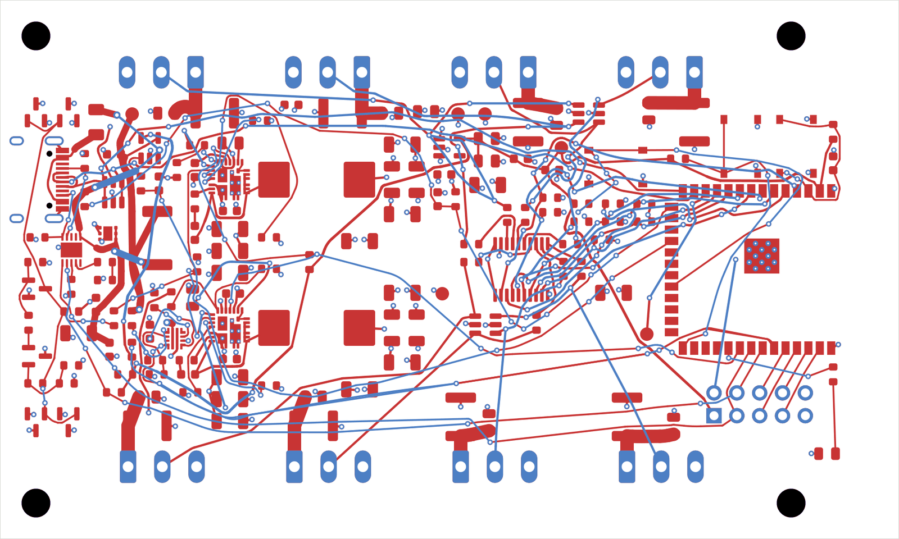

# Gummiband

Gummiband is a topological ("rubber band") autorouter for KiCad. It plans every connection as a
topology first (which side of which pad, via or locked track it passes) and only then turns the
plan into geometry: tight any-angle tracks with real arcs, pulled taut around the obstacles like
rubber bands between the pins. The router is written in Rust, uses every core of your machine and
comes as a KiCad plugin, a command line tool and an MCP server for AI agents.



What you keep is yours: everything you lock in KiCad (power lanes, a converter layout from the
datasheet, critical pairs) stays untouched and the router works around it.

Status: early development. Results route almost everything on real boards but still need a KiCad
DRC pass and some hand finishing. See the [milestones](docs/MILESTONES.md).

## Requirements

- KiCad 9 or 10 board files. The plugin needs KiCad 10 with the IPC API enabled.
- A Rust toolchain (edition 2024, so Rust 1.85 or newer): <https://rustup.rs>.
- Optional: `kicad-cli` (ships with KiCad) for DRC runs from scripts and the MCP server,
  `rsvg-convert` (librsvg) and ImageMagick for renders and animations.

## Setup

Build the router once:

```bash
git clone https://github.com/pfedan/gummiband
cd gummiband
cargo build --release
# binary: target/release/gummiband
```

Then pick how you want to use it:

- **KiCad plugin** (recommended): link the `plugin/` folder into KiCad's IPC plugin directory,
  enable *Preferences > Plugins > Enable KiCad API*, and tell the plugin where the binary is
  (`plugin/settings.json`, copied from `settings.example.json`). Step by step in the
  [installation guide](docs/guide/installation.md).
- **Command line**: use `target/release/gummiband` directly, see below.
- **AI agents**: `cargo build --release -p gummiband-mcp` builds the MCP server, see
  [Working with an AI agent](docs/guide/ai-agents.md) and the reference in [docs/MCP.md](docs/MCP.md).

## Quickstart

### In KiCad

1. Optional, for a board whose parts are not placed yet: lock the connectors and whatever else
   has its spot, click *Place with Gummiband* and pick which parts move (new, not yet tested
   live in KiCad).
2. Lock the copper you want to keep (select, right click, *Locking > Lock*).
3. Click *Route with Gummiband* in the PCB editor's plugin toolbar.
4. Leave the defaults (keep locked copper, 14 runs, via cost 3.0, 3 geometry
   generations) and press OK. A window shows the phase, the generation, the routed connections,
   vias, length and remaining violations. The result keeps improving until you press *Accept
   current result*; the window tells you when the search has settled.
5. Look at the result. It arrives as one undo step, so Ctrl/Cmd+Z takes it back entirely.
6. Refill zones (B) and run the DRC. Fix or reroute what is left by hand, then save.

Your board file on disk is not touched until you save.

### On the command line

```bash
# what the router sees: layers, planes, nets, net classes, rules
target/release/gummiband info my_board.kicad_pcb

# optional: place the parts that are not locked or mechanical, into a new file
target/release/gummiband place my_board.kicad_pcb -o my_board.placed.kicad_pcb

# route it (or the placed file), keep locked tracks and vias, write a new file next to it
target/release/gummiband route my_board.kicad_pcb -o my_board.routed.kicad_pcb --keep-locked

# judge the result with KiCad
kicad-cli pcb drc --refill-zones --format json -o drc.json my_board.routed.kicad_pcb
```

The `.kicad_pro` (net classes) and `.kicad_dru` (custom rules) next to the board are read
automatically. Copy them next to the output before running the DRC on it.

## Documentation

The user guide lives in [docs/guide](docs/guide/README.md):

- [A tour of the features](docs/guide/tour.md): what Gummiband does, one picture per feature.
- [Installation](docs/guide/installation.md): binary, plugin, optional tools, troubleshooting.
- [Placing and routing in KiCad](docs/guide/kicad-plugin.md): the plugin dialogs and what each
  option does.
- [Command line](docs/guide/cli.md): every command and option, the output and the JSON report.
- [Working with an AI agent](docs/guide/ai-agents.md): setup of the MCP server and a session
  from netlist to DRC, with the power and reference plane checks.
- [Workflows](docs/guide/workflows.md): locking power lanes, routing by priority, judging results,
  placing parts, movable parts, placement variants, animations.
- [How Gummiband routes](docs/guide/concepts.md): what the router respects, how it decides, and
  what it does not do yet.
- [Benchmarks](docs/guide/benchmarks.md): the synthetic suite and the real boards.

Reference and development:

- [docs/MCP.md](docs/MCP.md): the MCP server for AI agents, tools and client setup.
- [docs/ARCHITECTURE.md](docs/ARCHITECTURE.md): crates, data model, algorithms.
- [docs/MILESTONES.md](docs/MILESTONES.md): what is done and what comes next.
- [docs/DECISIONS.md](docs/DECISIONS.md): standing decisions and working rules of the project.
- [plugin/README.md](plugin/README.md): plugin internals, dry runs and tests.
- [bench/README.md](bench/README.md): the benchmark scripts.

## License

All rights reserved. Gummiband is not published under an open source license; ask the author
before using it beyond trying it out.
