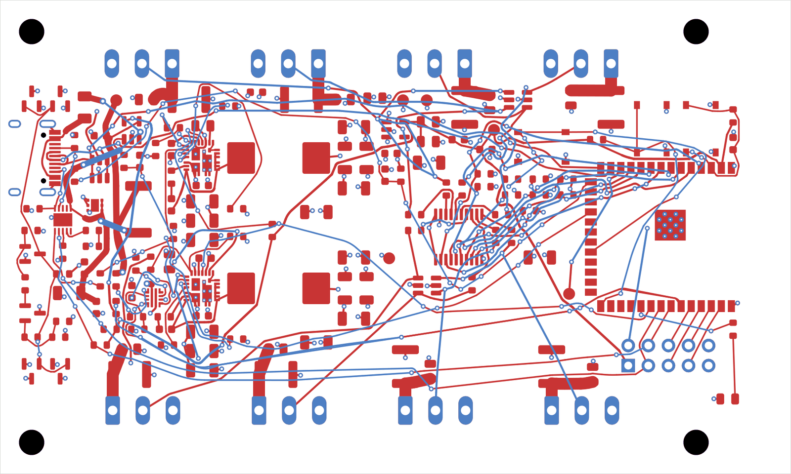

# Gummiband user guide

Gummiband routes KiCad boards with any-angle tracks and arcs, planned as topology first and
pulled taut afterwards. This guide is for people who want to route their boards with it. The
[main README](../../README.md) has the short setup and quickstart; the chapters here go into
detail.

| Chapter | Read it when |
| --- | --- |
| [A tour of the features](tour.md) | you want to see what Gummiband does, one picture per feature, before you read on |
| [Installation](installation.md) | you set up the binary, the KiCad plugin or the optional tools |
| [Placing and routing in KiCad](kicad-plugin.md) | you place or route from the PCB editor and want to know what the dialog options do |
| [Command line](cli.md) | you route from a shell or a script, or need the JSON report |
| [Choosing the opt-in options](options.md) | you wonder which of the hints and experimental options fit your board, and how to compare them |
| [Working with an AI agent](ai-agents.md) | you want Claude or another MCP client to plan, place, route and check a board for you |
| [Workflows](workflows.md) | you want recipes: locking power lanes, priorities, judging results, placing parts, movable parts, animations |
| [How Gummiband routes](concepts.md) | you want to understand what the router respects, how it decides, and its current limits |
| [Benchmarks](benchmarks.md) | you want to measure a change or compare against other routers |

The full reference of the MCP tools is [MCP.md](../MCP.md). The
internals are in [ARCHITECTURE.md](../ARCHITECTURE.md), the roadmap in
[MILESTONES.md](../MILESTONES.md), the standing decisions of the project in
[DECISIONS.md](../DECISIONS.md).

The pictures are in [img/](img/): result images from the benchmark boards and drawings of the
principles. The drawings are generated by `python3 docs/guide/img/src/schematics.py`; change the
script and run it again rather than editing the SVGs.

## Vocabulary

A few words this guide uses throughout:

- **Connection**: one pin to pin link the router has to make. A net with n pins has n - 1
  connections; a net that is a plane counts one connection per pin that has to reach the plane
  (a fan-out).
- **Locked copper**: tracks and vias with KiCad's lock flag. Gummiband never changes them and
  routes around them; their ends count as already connected copper the router may attach to.
- **Plane**: an inner copper layer that holds a pour of one net (GND, a supply) and is never
  routed. Layers of KiCad type *power* are planes; others can be declared with `--plane-layers`.
- **Run**: one complete routing attempt with its own order of connections. Gummiband runs many
  in parallel (the portfolio) and keeps the best.
- **Generation**: one round of the evolutionary search that mutates the best routing order and
  tries the mutants in parallel.
- **Geometry generation**: the same, but judged after the tracks were drawn, by the clearance
  check. Slower and cleaner.
- **Violation**: a clearance problem the router's own check finds in its result. KiCad's DRC is
  the final judge; the numbers are close but not identical.
