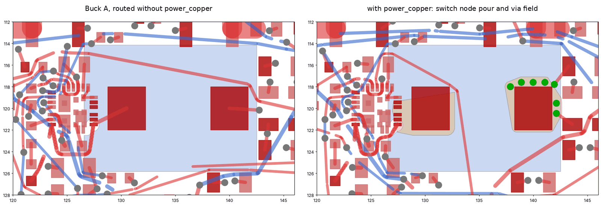
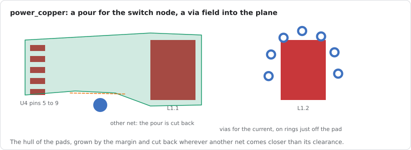
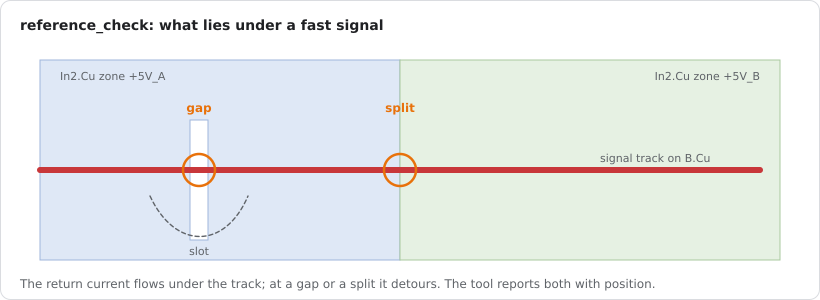

# Working with an AI agent

Gummiband comes with an MCP server, `gummiband-mcp`, so an AI agent such as Claude Code or Claude
Desktop can take a board from netlist to DRC: create or load the board, plan the planes and the
power copper, place the parts, route, check the current paths and the reference planes, run the
KiCad DRC and look at renders of the result. This chapter is the user's view: how to set it up,
what to ask for and what happens on the way. The full tool reference with every argument is in
[MCP.md](../MCP.md).

## Setup

1. Build the server next to the router:

   ```bash
   cargo build --release -p gummiband-mcp
   # binary: target/release/gummiband-mcp
   ```

2. Install the optional tools the server calls for `drc`, `render`, `ground_pour` and the zone
   refills: `kicad-cli` (ships with KiCad) and `rsvg-convert` (librsvg). See
   [Installation](installation.md#3-optional-tools).
3. Register the server with your client. In Claude Code:

   ```bash
   claude mcp add gummiband -e RAYON_NUM_THREADS=8 -- /path/to/gummiband/target/release/gummiband-mcp
   ```

   Claude Desktop takes the same command in its `claude_desktop_config.json`; the example with the
   tool paths is in [MCP.md](../MCP.md#claude-desktop).

Two things trip people up:

- **Tool paths.** MCP clients start servers with a short `PATH`. If `drc` or `render` say they
  cannot find `kicad-cli` or `rsvg-convert`, set `GUMMIBAND_KICAD_CLI` and
  `GUMMIBAND_RSVG_CONVERT` in the server's environment.
- **Time.** A route of a real board takes seconds to minutes. If the client gives up on long tool
  calls, raise its tool timeout (`MCP_TOOL_TIMEOUT` in milliseconds for Claude Code). The server
  uses 4 threads unless `RAYON_NUM_THREADS` says otherwise.

## What to ask for

The agent reads the tool descriptions and picks the tools itself, so plain requests work:

- "Load `~/boards/sensor/sensor.kicad_pcb`, route it and run the DRC. Show me the area around U3."
- "Route the USB and crystal nets first, then the rest, and compare three seeds."
- "Place the unplaced parts with the schematic in mind, try three seeds, route each and keep the
  best."
- "The buck converter carries 8 A. Plan the power copper before routing and check the current
  paths afterwards."
- "Check that the LED data lines run over unbroken ground."

Use absolute paths. The server never changes your input file: every tool that edits the board
writes a working copy next to it (`<input>.routed.kicad_pcb`, `<input>.prerouted.kicad_pcb`,
`<input>.gnd.kicad_pcb`, ...) and returns a new board id that the next steps use.

For the whole sequence there is a prompt: in Claude Code type `/mcp__gummiband__good_practice`
with the board path (and the currents if you know them). It asks the agent to go through every
step below without asking back unless the design intent changes, and to finish with a table of
the current paths.

## You stay the layouter

Gummiband's automatic tools complement manual work; the agent is not meant to hand the whole board
to `place_parts` and `route` and accept what comes back. It places the parts that matter itself
(`move_part`), draws critical copper by hand (`add_locked_copper`), lays out the planes and pours
(`set_layer_type`, `add_zone`, `power_copper`, `ground_pour`) and locks what must stay (`lock`).
The automatic tools then do the bulk around that: locked parts never move, locked copper is kept
and routed around. After every automatic step the agent can refine by hand again: move a part on
the routed board (its tracks follow), redraw one net and let the router join the rest, lock the
nets that came out well and route the others again.

Requests that use this:

- "Place J1, U6 and L1 the way the datasheet shows, lock them, then place and route the rest."
- "The router took the LED data line through the converter area. Draw it along the bottom edge
  by hand, lock it and route the rest of that net again."
- "Lock everything that is routed now and only route the nets that are still open."

The agent can read how to do this at any time: the tool `guide` returns the server's own
documentation, without a topic the workflow of manual and automatic steps, with a tool name (for
example `route` or `lock`) its full reference.

## A session from netlist to DRC

### 1. Get the board

- `create_board` builds a new board from a KiCad netlist: outline, layer count, planes, stackup,
  mounting holes, net classes and rules, footprints from your libraries. It reports parts whose
  pads do not match their pins.
- `load_board` reads an existing `.kicad_pcb` with its `.kicad_pro` and `.kicad_dru`: layers and
  which of them are planes, nets, classes, custom rules and the differential pairs it recognised.
- `list_nets`, `board_patterns` (pin rows, decoupling capacitors, buses between parts) and
  `part_info` (pads, courtyard and neighbours of one part) let the agent look before it acts.

### 2. Decide the layers

`set_layer_type` gives inner layers their KiCad type. A layer of type `power` is a plane: the
router reaches it with vias and routes no tracks there. `signal`, `mixed` and `jumper` are
routing layers. Many KiCad files mark every layer `signal`, so look at the `plane` flags of
`load_board` first. Then `add_zone` puts one zone per plane net on it (several zones side by side
make a split plane).

```json
{"name": "set_layer_type", "arguments": {"board": "b1", "layers": [
  {"layer": "In1.Cu", "type": "power"}, {"layer": "In2.Cu", "type": "power"}]}}
```

A GND plane next to every layer with fast signals or differential pairs is the rule of thumb;
`reference_check` (step 6) tells whether it worked.

### 3. Plan the power copper



- `power_plan` takes the currents per power net (globs allowed, a short term current where a fuse
  limits a short) and gives per net the IPC-2221 width per layer, the vias per layer change and
  advice: widen, keep off thin inner layers, or draw a pour instead of a track. Its `dru_rules`
  go into the project's `.kicad_dru`, so the KiCad DRC enforces the widths too. With `apply` the
  widths are used by the following routes.
- `power_copper` draws what a track carries badly: a pour over the pads of a current path (a
  converter's switch node from its pins to the inductor) and, for a net with a plane, a field of
  locked vias around a big pad.



The pour is the hull of the pads, grown by a margin and cut back wherever copper of another net
comes closer than its clearance; the vias sit on rings just off the pad and count only where they
land in the plane of their own net. On the LED controller this turned a single via into
seven and left no clearance violation near the converter.

- `add_locked_copper` places the copper a datasheet asks for (tracks as polylines, vias) as
  locked items; the router keeps it and attaches to it. `render` shows the agent what it drew.

### 4. Place the parts

`place_parts` places the parts that are not locked and returns the poses, the crossings and the
pins left off their plane. The same opt-in terms as on the command line apply: `semantic`,
`corridors`, `escape_halo`, `leash` and `two_sided`; [Choosing the opt-in
options](options.md) says which board wants which. `move_part` moves one part where the agent has
a plan for it, and `track_corridors` lists the bands of the buses and the parts in their way
without moving anything.

Placement seeds differ a lot. Let the agent try two or three, route each and keep the best.

### 5. Route

`route` takes the options of `gummiband route`: `seed`, `generations`, `geometry_generations`,
`patterns`, `pairs` and `pair_pull`, `angles: "45"`, `open_end_seconds` for the open end, and
the length tuning (`tune`, on by default when the rules ask for it). `set_net_options` gives nets
a priority, a width or `skip` before the run.

The result names every unrouted connection with the nets that run in its way, the violations with
position, the length rules that failed and how much of each pair runs coupled. That is what the
agent iterates on: give a blocked net priority, move a part, route again. On a finished board
`route` with `keep_all`, `nets` and `reroute` lays single nets again while everything else stays.

`angles_45` turns a finished file into 45 degree routing without routing again.

### 6. Check and finish

- `current_check` walks each current path of the written file and reports the narrowest band and
  the total cross-section between the terminals, pours and vias included, with a verdict.
- `ground_pour` pours ground on the outer layers and stitches it with locked vias along the edge
  and in a grid, then fills the zones.
- `reference_check` looks under every fast signal track: a `gap` where the reference layer has no
  copper (a slot, merged antipads), a `split` where the track crosses from one zone net into
  another. KiCad's DRC does not check this.



- `drc` runs the KiCad DRC with zone refill and summarizes it: counts per type, the unconnected
  items, a histogram of the clearance deficits and the worst ones with positions.
- `render` returns a PNG of the board or of a region, so the agent (and you) can look at a spot
  the DRC named.

## Tips

- **Seeds over options.** Results scatter from seed to seed. Ask the agent to compare a setting
  over the same two or three seeds and by the KiCad DRC, not by one run.
- **Lock what you made by hand.** Locked tracks, vias and footprints stay through every tool.
  `lock` locks parts by reference, the copper of nets or all copper, and `unlock: true` releases
  them again.
- **Keep the project files together.** `drc` needs the `.kicad_pro` next to the board; `route`
  copies it (and the `.kicad_dru`) next to its output when it is missing.
- **Open the result in KiCad.** Refill the zones (B) and run the DRC there before you send the
  board to the fab; the tuning patterns, zones and locked items are ordinary KiCad items.

## Limits

- Only one `route` runs at a time; other tools keep answering meanwhile.
- Re-laying single nets on a finished board (`keep_all`, `nets`, `reroute`) shoves unlocked
  tracks of other nets aside and lets those within 8 mm give way, but locked copper and plane
  nets never move; where they leave no room, a net may stay open.
- Datasheet guided pre-routing (`part_info` and `add_locked_copper`) is new and has seen few real
  boards. Check the pre-routed copper with `render` before routing.
