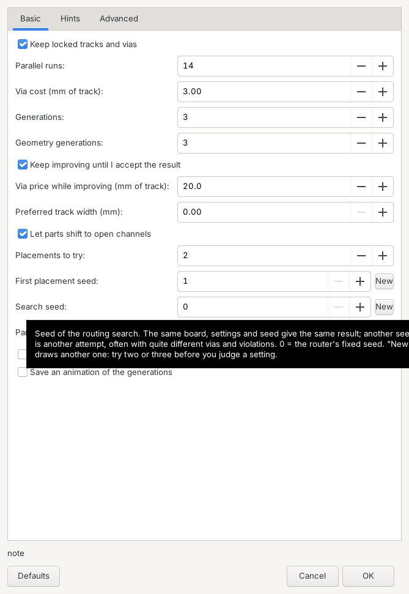
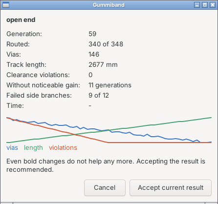
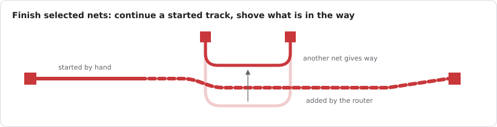
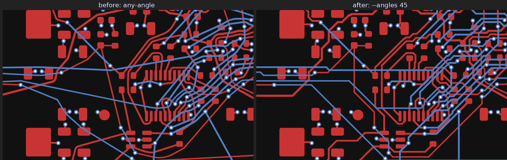
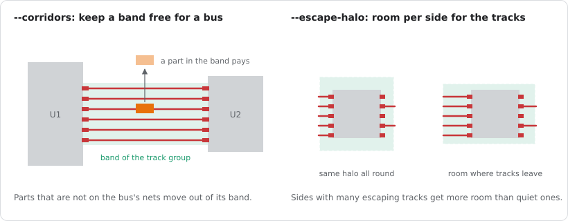
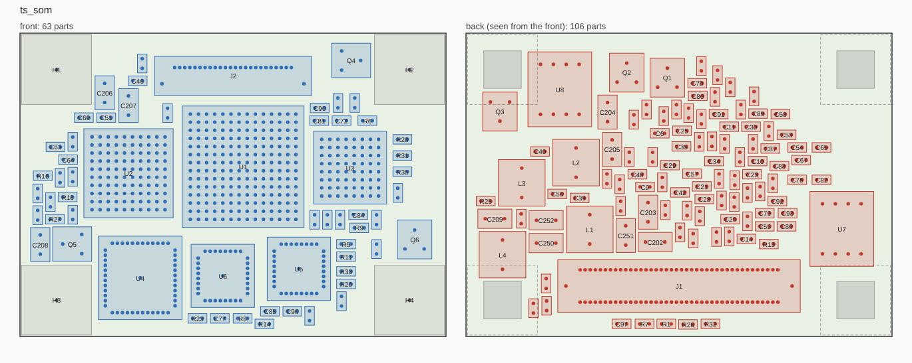

# Placing and routing in KiCad

The plugin adds four actions to the PCB editor's plugin toolbar: *Route with Gummiband*, *Finish
selected nets with Gummiband*, *45 degree tracks with Gummiband* and *Place with Gummiband*. Each exports a copy of the open board
with its project to a temp folder, runs the `gummiband` binary on the copy and imports the result
into the open board as **one undo step**. Your file on disk is only changed when you save. This
chapter describes the routing action first, then the newer ones.

Setup is in [Installation](installation.md).

## Before you click

- **Lock what must stay.** Select the tracks and vias you routed by hand (power lanes, the
  layout a datasheet asked for, a matched pair), right click, *Locking > Lock*. Locked copper is
  kept and treated as an obstacle; its ends count as connected, so the router attaches to it.
- **Check the net classes.** Track width, clearance and via size come from the net classes in
  the project (*Board Setup > Net Classes*). Custom rules in the `.kicad_dru` are honoured for
  clearances between nets and for minimum track widths, see [concepts](concepts.md#rules).
- **Planes.** Inner layers of type *power* are planes: they are not routed, their pours stay, and
  pins of the plane's net get a via to the plane instead of a track.
- **Save the project once** so the `.kicad_pro` with the net classes exists next to the board.

## The dialog

The dialog has two tabs, and every field explains itself in a tooltip. It can be resized: the
fields grow with its width, and a tab scrolls when the dialog is lower than its fields. It remembers its last values
in the plugin's `settings.json`; references, layer names and net files start empty every time,
because they fit only one board. *Defaults* brings back the values below.

**Basic**

| Option | Default | What it does |
| --- | --- | --- |
| Keep locked tracks and vias | on | Locked copper stays and is routed around. All unlocked tracks and vias are replaced. Off: everything is replaced, locked or not. |
| Parallel runs | 14 | How many routing attempts with different orders are tried in every phase. The default is a constant, not the core count, so the same board gives the same result on every machine; the core count only changes how long it takes. More runs explore more orders. |
| Via cost (mm of track) | 3.0 | How much track a via is worth to the router. Lower values give more vias and shorter tracks, higher values fewer vias. The search also tries values around it. |
| Generations | 3 | Rounds of the order search after the first runs, judged by routed connections, vias and length. |
| Geometry generations | 3 | Extra search rounds judged by the clearance check of the drawn tracks, not only by the topology. 0 is fastest; each round costs about one full routing pass and removes violations. |
| Placements to try | 0 | Places the parts that are not locked or mechanical from the netlist this many times, routes each result and keeps the best (`--placements`). Each one costs a full route. The parts, their keepouts and the tracks arrive in one undo step. Locked tracks stay, parts keep clear of them and a part with locked copper on a pad stays. |
| Keep improving until I accept the result | on | After the normal search the router keeps working on the result until you press *Accept current result*. Not together with pairs routed as one wide track. |
| Via price while improving (mm of track) | 20 | With *Keep improving*: how much track a via is worth when the improvement judges its results (`--open-via-cost`). Lower gives more vias and shorter tracks, higher fewer vias and longer tracks. |
| Preferred track width (mm) | 0 (off) | Tracks of the default net class push aside what can give way and grow up to this width where there is room, with a taper at every change of width. Other classes get a target of their own with a custom rule `track_width (opt ...)`, see [Wider tracks where there is room](concepts.md#wider-tracks-where-there-is-room). |
| Let parts shift to open channels | on | The geometry generations may shift parts next to clearance problems and open connections (`--move-parts`), so at least one of them is needed; the routed tracks follow like rubber bands. A setting remembered from an earlier version stays as it was: tick it once. Finishing nets leaves the parts where they are. Locked footprints, connectors, modules, mounting holes, switches, jumpers and test points stay. The moved footprints arrive in the same undo step as the tracks, and the message box lists them. |
| First placement seed | 1 | With *Placements to try*: the placements use this seed and the ones after it (`--placement-seed`). After every run it moves on by the number of placements, so the next run tries placements it has not seen; the message box names the seed that won. *New* draws another one. |
| Search seed | 0 (fixed) | Seed of the routing search (`--seed`). The same seed gives the same result, another seed another attempt, often with quite different vias and violations. *New* draws one; try two or three before judging a setting. |
| Parts that never move | | With the option above: references that stay in addition (`--fixed`). |
| Open Edit Teardrops after routing | off | Opens KiCad's *Edit Teardrops* dialog after the run. Enable the teardrops there: the plugin cannot do it itself, see below. |
| Save an animation of the generations | off | Writes one image per generation and an `evolution.gif` into `gummiband-evolution/` next to the project. Needs `rsvg-convert` and ImageMagick. |

**Hints**

Options that are off because none of them wins on every board. The tab says in a few lines which
board wants which, and the tooltips give what each one did in the measurements. The full
comparison is in [Choosing the opt-in options](options.md). Compare an option with a plain run
over the same two or three search seeds: one run says little.

| Option | Default | CLI | What it does |
| --- | --- | --- | --- |
| Route buses between parts as blocks | off | `--patterns groups` | The connections between two parts that share at least two nets are routed as one block in pin order. Fewer vias on boards with several chips; leave it off on a placement that already routes cleanly. |
| Order of the blocks | Longest first | `groups-short` | *Shortest first* suited a DDR fan-out and hurt elsewhere. |
| Differential pairs first | off | `--patterns pairs` | Pairs before the rest, longest first. With the blocks the best result on an FPGA board with many pairs. |
| Decoupling capacitors first | off | `--patterns decaps` | A capacitor to its IC pin first, one via for both. Helps boards with many decaps. |
| Lay pin rows again in pin order | off | `--patterns rows` | Only with *Keep improving*. |
| Neighbouring plane pins share a via | off | `--patterns shares` | Rarely helps, for experiments. |
| Move small parts out of the way of buses | off | `--clear-corridors` | Experimental: before routing, parts in the band of a bus that are not on its nets get new positions next to it; ICs and connectors move at most 1.5 mm, decoupling capacitors stay. For tight boards with several chips, together with the blocks. The moves arrive in the same undo step, and the message box lists them. |

**Advanced**

| Option | Default | CLI | What it does |
| --- | --- | --- | --- |
| Via grid pitch | 0.5 mm | `--via-pitch` | Spacing of the sites where vias may go. Finer finds more ways through tight spots and takes longer. |
| Layer direction weight | 0.5 | `--layer-dirs` | How strongly every third run prefers horizontal and vertical tracks on alternating layers. |
| Via removal factor | 4.0 | `--via-pass` | Factor on the via cost in the pass that routes connections with vias again and keeps what has fewer vias. |
| Negotiation rounds | 0 | `--negotiate` | A second search from the start in which connections compete for room. 20 rounds work well and take about twice the time. With 0 the search negotiates on its own when it leaves a few connections open. |
| Worker threads | 0 (all) | `--threads` | How many cores the run may use. The result does not depend on it. |
| Relax on the GPU | off | `GB_GPU=1` | Experimental, macOS only: runs most of the track relaxation as a compute shader. Needs a binary built with `--features gpu`; with a normal binary the run stays on the CPU and the message box says so. Results differ between GPUs, so use the CPU for a final run. |
| 45 degree tracks | off | `--angles 45` | Turns the any-angle tracks and arcs into conventional 45 degree routing at the end, with chamfered corners. A few percent more length, no new clearance violations; where no 45 degree path fits, a piece keeps its angle. See [Conventional 45 degree tracks](concepts.md#conventional-45-degree-tracks). |
| Plane layers | | `--plane-layers` | Copper layers to treat as planes, on top of those of KiCad type *power*. |
| Leave nets with a zone to its fill | off | `--areas fill` | Experimental: a net with a zone on a routed layer (a ground pour) gets no tracks. The fill of the zone connects it, and the result names the pads the fill does not reach. The run then ends on its own instead of improving until accepted. |
| Planned pours (nets) | | `--pour` | With the option above: nets that get a pour on both outer layers after the route. The route takes the pour as the zone of the net; lay it afterwards. |
| Net widths file | | `--net-widths` | JSON file with a track width per net, or an object of options per net (see the CLI reference). |
| Net priorities file | | `--net-priorities` | JSON file with a routing priority per net; lower routes first. |
| Route pairs as one wide track | off | `--pairs` | Experimental: routes each differential pair as one wide track and splits it into two. Costs connections on dense boards. |
| Length difference | 0.1 mm | `--pair-skew` | With pairs: length difference left within a pair. |
| Differential impedance | 0 (off) | `--pair-zdiff` | With pairs: sets the track width per layer from the stackup. |
| Also pairs without a pair rule or class | off | `--pair-all` | With pairs: every pair recognised by name. |
| Vias of a pair as one capsule | off | `--via-pairs` | Experimental, with pairs: two vias side by side turn with the pair as one capsule. Helps pairs that change layers often. |
| Single tracks into the pads | off | `--breakouts` | Experimental, with pairs: the wide track ends just outside the pads. Helps at connector rows, not yet on DDR. |
| Pair pull | 0 | `--pair-pull` | How strongly the two nets of a pair attract each other while routing; 1 is a good start. The gentle way to couple pairs on a board that is not dense. |
| Extra air over the clearance | 0.03 mm | `--air` | With *Keep improving*: reserve on top of the clearances where there is room. |

**Teardrops.** KiCad's plugin API has no setting for teardrops on vias and pads, so `--teardrops`
cannot act on the open board. The check box opens KiCad's own dialog instead. The wedges at track
width changes are a project setting in *Board Setup*. Footprints in a KiCad group move in the plugin
too, but tracks and vias kept in such a group stay where they are; the message box warns about it.

Press OK and a window shows the phase (portfolio, generation n, geometry, geometry generation n,
polish), the generation, the routed connections, vias, track length and the remaining violations
of the best candidate so far, and how they went over time. *Cancel* stops the router and leaves
the board as it was.

With *Keep improving* on, the result gets better for as long as you let it: fewer vias, fewer
violations, sometimes the last connections. *Accept current result* takes the best result so far
at any time after the first geometry generation, and it takes a moment to finish it. Once the
search has converged, the window recommends to accept: 12 side branches in a row, each bolder than
the last, did not help. You can also let it go on. If results remain that differ in vias and
length, a list offers them before the result is taken over.

## After the run

A message box reports what was removed and created, the router's summary (routed connections,
vias, length, violations) and the connections it could not route, if any.

1. **Look at the result.** Tracks are any-angle with arcs; this looks different from grid
   routing and is intended.
2. **Refill zones** (B). The plugin does not refill them, so pours and plane connections show up
   only after the refill.
3. **Run the DRC.** Gummiband checks clearances itself, but KiCad's DRC is the judge. Expect a
   small number of clearance items on dense boards in this early version; the deficits are
   usually a few micrometres and quick to fix by nudging a track.
4. **Finish by hand** what is unrouted, lock what you want to keep, and route again if you like.
   Every run replaces only unlocked copper, so you can iterate: lock the good parts, reroute the
   rest.
5. **Undo** with Ctrl/Cmd+Z takes the whole routing back in one step.

## Finish selected nets (follow-me, experimental)

The second toolbar button, **Finish selected nets with Gummiband**, completes the nets you point
at instead of rerouting the board:

1. Start a track by hand if you like, or just select any track, via or pad of the nets you want
   finished (several nets at once are fine).
2. Click the button. Without a selection the plugin asks for one.
3. The router adds what is missing on the selected nets, continuing a started track from where
   it ends: copper that touches no pad of its net counts as a pin, so the new track starts right
   there. Unlocked tracks of other nets shift aside a little where the new connection needs the
   room; what the new track does not touch stays exactly as it was. If there is still no way,
   unlocked tracks of other nets within 8 mm of the pin are rerouted. Locked copper and plane
   nets such as GND never move.
4. The additions arrive as one undo step. There is no dialog: the action runs with the defaults
   (14 runs, via cost 3.0) and without geometry generations, so it is quick.

This is the plugin's form of `gummiband route --keep-all --nets A,B` (it passes `--shove --give 8`, the defaults there). The
button is new and not yet tested live in KiCad. Refill the zones (B) before you run the DRC:
after vias moved, stale plane fills report errors that are not there. Moved vias lose their
teardrop settings.

## 45 degree tracks

The button **45 degree tracks with Gummiband** turns a finished any-angle result into
conventional 45 degree tracks without routing again, for example after you have looked at the
any-angle routing and decided the reviewer wants 45 degrees after all:

1. Select a track, via or pad of the nets to convert, or select nothing to convert all nets.
2. Click the button. There is no dialog; it takes a second or two.
3. The unlocked tracks of those nets get straight pieces in the eight directions of the 45
   degree grid and chamfered corners. Vias, track ends, pads and locked tracks stay where they
   are, and every new piece keeps the clearances: where no 45 degree path fits, a piece keeps its
   angle. Tracks that do not change stay as they are.
4. Everything arrives as one undo step, and a message gives the removed and created items and
   the length before and after.

This is the plugin's form of `gummiband angles45`. The same step can run at the end of routing
with *45 degree tracks* under *Advanced*; see
[Conventional 45 degree tracks](concepts.md#conventional-45-degree-tracks).

## Place with Gummiband

A second step with its own toolbar button, used before routing. In the dialog you pick which parts
move:

- **Selected parts**, preset when footprints are selected.
- **Parts outside the board**, for footprints fresh from the schematic.
- **All unlocked parts**, connectors, modules, holes, buttons and test points stay.
- **All unlocked parts, those too.**

Locked footprints never move. *Also keep* takes references that should stay in addition. The
other fields are *Parallel runs* (independent placements, the one with the fewest crossings
wins, 1 by default: the crossings hardly predict how well the board routes), *Courtyard spacing* (0.3 mm), *Room around ICs* (0.3 mm extra for parts with
five or more pads) and *Seed* (1); placements differ a lot from seed to seed, so for another attempt
press *New* next to it. The *Strategy* tab has the options of a placement from scratch, all off:
*Use the schematic* (`--semantic`), *Keep bands free for buses* (`--corridors`), *Room for the
escape per side* (`--escape-halo`), *Leash for ICs and connectors* (`--leash`, mm, 0 = free) and
*Place on both sides* (`--two-sided`) with *Cost of a part on the back* (`--back-cost`, 6 mm) and
*Largest part for the back* (`--back-max-pads`, 8 pads).

The first three together gave the cleanest placements of the LED controller; the
tooltips say what each does, and [Choosing the opt-in options](options.md) compares them. The
*Advanced* tab has *Release* (parts that may move although they count as mechanical),
*Distance to the outline* (0.5 mm), *Annealing moves per run* (3,000,000), *Worker threads* and
*Plane layers*. They are the options of [`gummiband place`](cli.md#gummiband-place), and the dialog
remembers its numbers like the routing dialog does.

The footprints and the keepouts that belong to them move in one undo step, so Ctrl/Cmd+Z takes the
placement back entirely. With *Place on both sides* the parts that change sides are flipped by
KiCad itself in the same step; that needs KiCad 10.0.6 or newer and kicad-python 0.8 (the API to
flip items), an older KiCad gets a clear message and keeps the board as it was. Tracks and vias do not follow, so use it before routing. The message box
at the end says how many parts moved, how many stayed, the crossings between the nets and which
pins ended up off their plane, with both sides also how many parts sit on the back and how many
changed sides. Without wxPython the action runs with the defaults: the selected
parts if there is a selection, otherwise all unlocked parts.

The button is new and not yet tested live in KiCad. The placer knows no datasheet layouts: place
a power stage or a crystal by hand, lock it, and let the button do the rest around it. Without
*Place on both sides* the parts of both sides share the same space, so a two sided board comes out
less dense than it could be.

## Without a dialog

If the plugin's Python has no wxPython (a Linux system interpreter, for example), the action runs
with the saved values or the defaults from the tables above and prints its report to the status bar (KiCad 10.0.1 and
later). Use the [command line](cli.md) for full control in that case.

## What the plugin does not do yet

- Route a selection of the board. *Route with Gummiband* replaces all unlocked copper; lock the
  copper you want to keep. *Finish selected nets* adds to existing copper but is experimental.
- Set per net priorities or skip nets. Priorities come from the net classes; the MCP server and
  the CLI report offer more control, see [workflows](workflows.md#route-by-priority).
