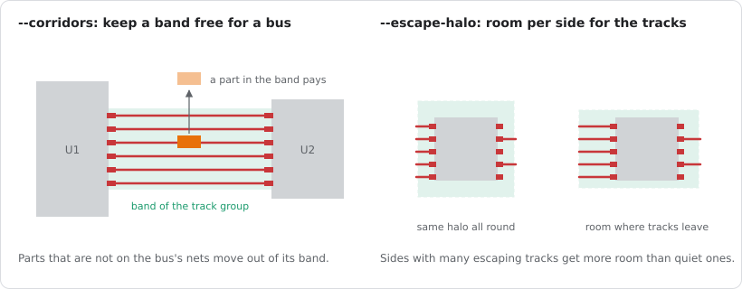
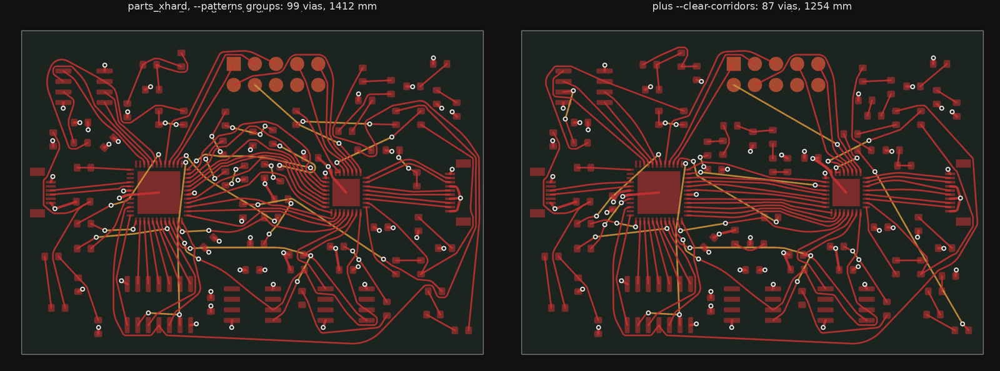
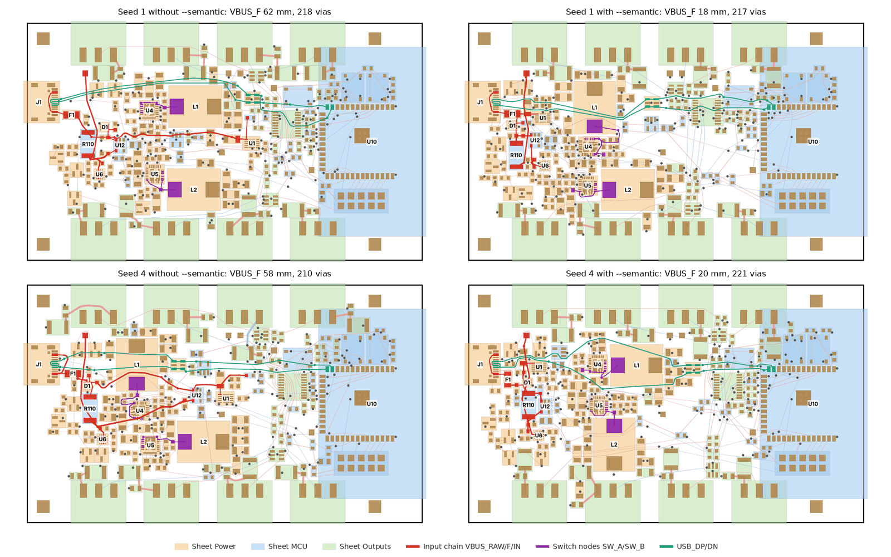
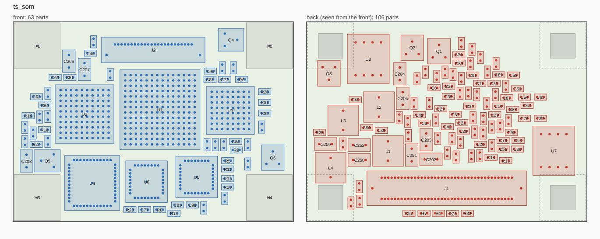
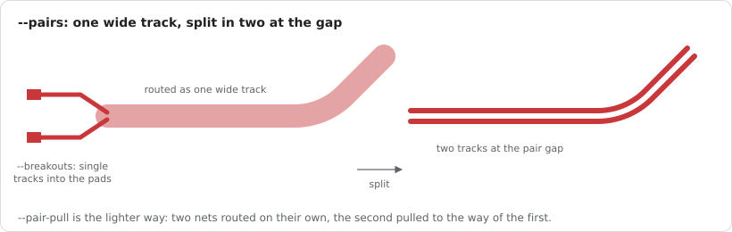

# Choosing the opt-in options

Gummiband has a growing number of options that are off by default: routing order hints,
placement terms, the experimental pair modes. They are off because none of them wins on every
board. Each one helps a certain kind of board and costs on another, so the choice depends on the
board in front of you. This page says what each option does, where it helped and where it hurt
in the measurements of [MILESTONES](../MILESTONES.md), and how to try it. The KiCad plugin shows
the same advice in its tooltips, and the MCP server gives a short version of it to AI agents.

## Before you compare: seeds

The search is chaotic. Another seed of the same settings can change a result by 10 to 20 % in
vias and give 0 or 14 clearance errors on the same board. A single run therefore says little
about an option.

- Compare two settings over the same 2 or 3 seeds (`--seed`, the plugin's *Seed*, `seed` in the
  MCP `route`), and look at the mean and the worst case, not at the best run.
- Placements differ even more from seed to seed than routes: `place --seed`, the plugin's
  placement seed, `place_parts` `seed`. A good placement seed is worth more than any routing hint.
- Judge with the KiCad DRC (`drc` in the MCP), not only with Gummiband's own clearance count.

## Which board, which options

| Board | Try first | Leave off |
| --- | --- | --- |
| Several chips with buses between them (MCU and PHY, SPI, parallel interfaces) | `--patterns groups`; on a tight board also `--clear-corridors` | `groups-short` |
| FPGA or BGA board with differential pairs and buses (Arty) | `--patterns pairs,groups` | `shares` |
| DDR memory fan-out | `--patterns groups-short`; `--pairs band --via-pairs` for the strobes and clocks | `--breakouts` |
| Fine pitch keyboard style board, no planes (Corne) | nothing; `rows` in the open end | `decaps`, `pairs,groups` |
| Fixed placement that already routes cleanly (LED controller) | nothing, or `decaps`; spend the time on seeds and the open end | `groups`, `pairs,groups`, `--clear-corridors` |
| Placement from scratch | `place --semantic --corridors --escape-halo`, several placement seeds, then route without hints | `--starts` above 1 instead of seeds |
| Parts that do not fit on one side | `place --two-sided`; `--back-max-pads` or `--on-back` when the ICs that keep the front are the problem | `--back-cost 0` unless the back is meant to be full |
| Differential pairs that must couple, board not dense | `--pairs pull`; `--pairs band` if the pairs have their own rule or class | `--pairs band` on dense boards |

## Routing order hints: `--patterns`

`gummiband info` (MCP `board_patterns`) lists what the hints would act on. Several can be
combined, comma separated. Without hints the routing order is byte for byte what it was before
they existed.

| Hint | What it does | Helped | Hurt |
| --- | --- | --- | --- |
| `groups` (= `groups-long`) | The connections between two parts with 4 or more pins that share at least 2 nets (a bus, SPI, I2C, a connector) are routed as one block in pin order, so they do not cross each other; the longest block goes first. | Boards with several chips: parts_hard 56 to 49 vias, parts_multi_feed 127 to 98, crossing 26 to 15. | A board whose placement is fixed and already clean (LED controller: 0 to 0.3 clearance errors); a few percent more length. |
| `groups-short` | As `groups`, the shortest block first. | DDR5 (fewest DRC errors of all orders). | Most other boards: LED controller 5 clearance errors, parts_multi 84 instead of 59 vias. |
| `pairs` | Differential pairs first, the longest first, both nets next to each other. | Shorter, better coupled pairs (pair_traffic 581 to 503 mm, uncoupled 4.0 to 2.2 mm); with `groups` the best result on Arty (161 to 141 vias). | Costs vias and DRC errors when the pairs are the minority (diff_pairs). |
| `decaps` | A decoupling capacitor is connected to its IC pin first; the via serves both. | LED controller about 7 % lower cost. | Corne much worse; Arty even. |
| `rows` | The open end lays the connections of a pin row again in pin order. Acts only with `--until-stop`. | Small gain on every run measured, Corne complete. | Three runs are no proof yet. |
| `shares` | Pins of a plane net next to each other reach the plane through one via. | Rarely: the router shares close vias anyway. | Arty 70 vias more. |

## Room for track groups

| Option | What it does | Use it when |
| --- | --- | --- |
| `route --clear-corridors` | Before routing, the movable parts that sit in the band of a track group (see `groups`) without being on its nets are placed again around it. ICs and connectors in a band move at most 1.5 mm (`GB_CC_LEASH`), decoupling capacitors stay at their IC. | A tight board with several chips, together with `--patterns groups`: parts_xhard 18 % fewer vias and 8 % less length. Not on a board whose placement you have settled: it moves parts. |
| MCP `track_corridors` | Lists the track groups, their bands and the parts in the way, and moves nothing. | An agent that wants to decide part by part: move some of the listed parts with `place_parts` (`only`, `corridors: true`, `leash: 1.5`) and leave the rest. |
| `place --corridors` | The annealer keeps a band free for every track group; parts in it pay. | Placement from scratch on a board with buses: fewer vias. |
| `place --escape-halo` | Each side of a part with 5 or more pads gets room for the tracks that leave it, instead of the same halo all round. | Placement from scratch: no more missed connections at tightly packed ICs, about 15 % more length. |
| `place --semantic` | Uses the schematic: sheets and IC clusters stay together, inductors at their converter, decaps at an IC of their sheet. | Placement from scratch of a board with power stages: the cleanest results on the LED controller together with the two options above. |
| `place --leash MM` | Parts with 4 or more pads stay within MM of where they sit. | A local change instead of a new placement, typically with `--only`. |

What `--clear-corridors` did on the tightest synthetic board, together with `--patterns groups`:

And what `--semantic` does to a placement from scratch: the parts of a sheet stay together, the
inductors at their converter, so the supply paths get short.

## One side or two

Off by default: without it every part keeps its side and both sides share one room.

| Option | What it does | Use it when |
| --- | --- | --- |
| `place --two-sided` (MCP `two_sided`, plugin *Place on both sides*) | Each side gets its own room. Small SMD parts (up to `--back-max-pads`, 8) may change sides and are flipped as KiCad flips them; through hole parts take only their holes on the other side. | The parts do not fit on one side (a one sided placement says so before it searches, and whether both sides have the room), or a board meant for parts on the back. Leave it off for a board assembled on one side. |
| `place --back-cost MM` | What a part on the back costs in mm of wire, 6 by default. | Lower (0 to 2) to let decoupling capacitors and small parts go under their IC freely; higher (15 and more) to keep the back for what does not fit. On a roomy synthetic board 10, 6 and 3 parts went to the back at 2, 6 and 15. |
| `place --back-max-pads N` | Parts with more pads keep their side, 8 by default. | Raise it when the ICs that keep the front are what does not fit (the error of a failed run says so). |
| `place --on-front`, `--on-back` | These parts go on that side, whatever their pads. | A large IC on the back under a module, a part that has to stay on top. |

## Differential pairs

`--pairs` (MCP `pairs`, plugin *Differential pairs*) says how the two nets of a pair are laid:
`off`, the default, each net on its own; `pull`, the gentle way; `band`, one wide track.

| Option | What it does | Use it when |
| --- | --- | --- |
| `--pairs pull` | The second net of a pair is pulled to the way of the first; the tracks close up to the pair gap afterwards. `--pair-pull W` sets the weight, 1 by default and a good start. | Pairs should run together but the board is not dense. Works for every recognised pair. |
| `--pairs band` | Each pair is one wide track, split in two at the end. Only pairs with a `diff_pair_gap` rule or their own net class. | Pairs that must stay coupled and have room. Costs connections on dense boards; check with the DRC. Not with `--until-stop`. |
| `--pair-all` | With `--pairs band`: every pair recognised by name, also in the default class. | Pairs without a rule or class of their own. |
| `--pair-pull W` | With `--pairs band`: the pull of `--pairs pull` for the pairs that get no wide track, 0 by default. | A board with marked pairs and a few pairs by name only that should still run together. |
| `--via-pairs` | With `--pairs band`: two vias side by side are one capsule that turns with the pair. | Pairs that change layers often (DDR5: 185 instead of 206 errors). |
| `--breakouts` | With `--pairs band`: the wide track ends just outside the pads, two short tracks go in. | Connector rows (diff_pairs, matching). Still worse on DDR5. |

The sub-options of the wide track (`--pair-all`, `--via-pairs`, `--breakouts`, `--pair-skew`,
`--pair-zdiff`) are refused without `--pairs band`, and `--pair-pull` without `--pairs pull` or
`band`: an option that would do nothing is an error that says what to write.

## How much search: `--preset`

One word for the effort of a run (MCP `preset`). A preset sets the four options
`--runs`, `--generations`, `--geometry-generations` and `--open-end-seconds`; each of them wins
over the preset when you give it. It changes no other option, and no hint.

| Preset | Sets | Use it when |
| --- | --- | --- |
| `draft` | 4 runs, 1 generation, no geometry generations | You want to know quickly whether the board routes and where it is tight: after a placement, between two tries of an agent. Many clearance violations. |
| `quick` | 14 runs, 3 generations, no geometry generations | A first result to look at, in about a third of the time of `standard`. |
| `standard`, the default | 14 runs, 3 generations, 3 geometry generations | A usable board. |
| `final` | `standard`, then 10 minutes of the open end | The last run of a board. |

Compare options with the preset you will use in the end: a hint that helps the draft may not
help the final run.

## What stays on the board: `--scope`

Not a tuning option, but the first choice of every run: what of the copper on the board the
router keeps (MCP `scope`, plugin *Keep locked tracks and vias* and *Finish selected nets*).

| Scope | What it does | Use it when |
| --- | --- | --- |
| `fresh`, the default of the command line | Every track and via goes, locked or not, and the board is laid anew. | A benchmark, or a board to start over. |
| `keep_locked`, the default of the plugin | Locked tracks and vias stay as fixed copper, all unlocked copper is laid anew. | The copper that must stay is locked: a datasheet layout, a power lane, nets you are happy with. |
| `finish` | All copper stays and only what is still open is laid; with `--nets` only those nets. | You laid some nets by hand and want the rest finished, or a track was started. |
| `reroute` | The unlocked copper of `--nets` goes and they are laid anew; everything else stays. | One net came out badly on a routed board. |

Some defaults follow from the scope. Parts move (`--move-parts`) with `fresh` and `keep_locked`
only. Where single nets are laid on kept copper (`reroute`, or `finish` with `--nets`) the tracks
of other nets shift aside and give way within 8 mm (`--shove`, `--give 8`), and an open ended
run adds no `--air`.

## Finishing the result

| Option | What it does | Use it when |
| --- | --- | --- |
| `--until-stop` (plugin: *Keep improving*), `--open-end-seconds S` (MCP: `open_end_seconds`) | Keeps improving after the search until you accept, or for S seconds. | The final run of a board. The window says when it has found its level. |
| `--air MM` | Gives the copper a reserve over the clearance where there is room. 0.03 by default in an open ended run. | Bundles right at the limit, or a fab with tolerance worries. A result with new violations is dropped. |
| `--move-parts` | Parts next to problems shift a little while the copper follows. On by default where the board is laid anew (scope `fresh` and `keep_locked`). | Almost always; switch it off for a board whose parts must not move at all. |
| `--placements N` | Places the board N times, routes each and keeps the best. | Early in a design, when the placement is open. Costs N routes. |
| `--negotiate N` | A negotiated search from the start. | Dense boards that leave connections open; the default takes it up on its own. |

## How to try an option

1. Route the board as it is with seeds 1, 2 and 3 and note vias, length and DRC errors.
2. Route it with the option and the same seeds.
3. Keep the option if the mean is better and the worst run is not worse. Keep it per board: what
   helps one board is no default for the next.
