# A tour of the features

This page shows what Gummiband does, one picture per feature, and points to the chapter that
explains how to use it. The result images come from the boards of the
[benchmarks](benchmarks.md): the Lichtschnitzel LED controller (a real four layer board), the
synthetic test boards and a DDR5 testbed. The drawings explain a principle and are not to scale.

Top layer copper is red, bottom layer copper is blue in all pictures.

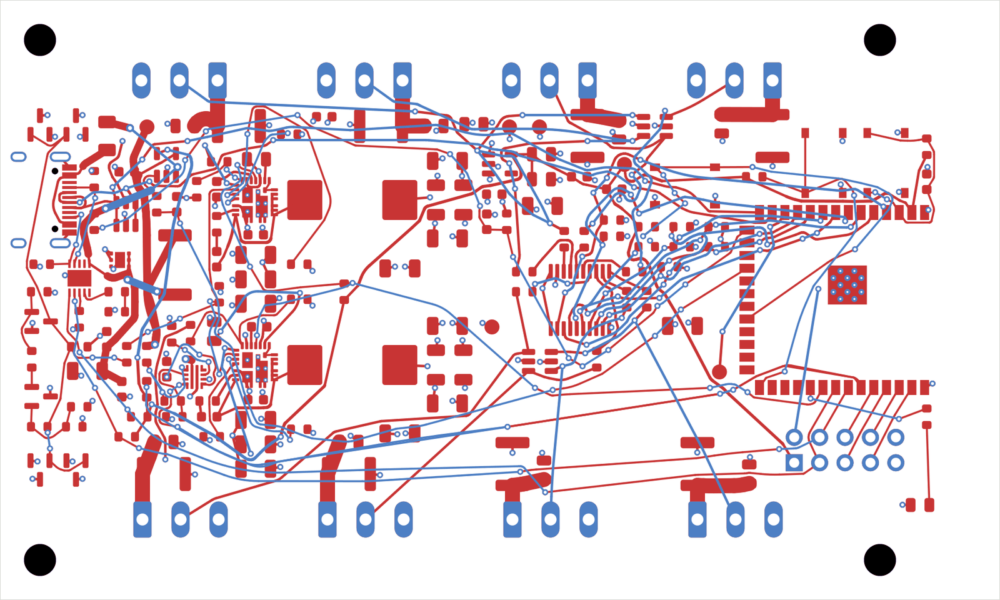

*The Lichtschnitzel controller as Gummiband routes it: every connection made, tracks with any
angle and real arcs. The inner layers are planes and not shown.*

## Rubber band routing

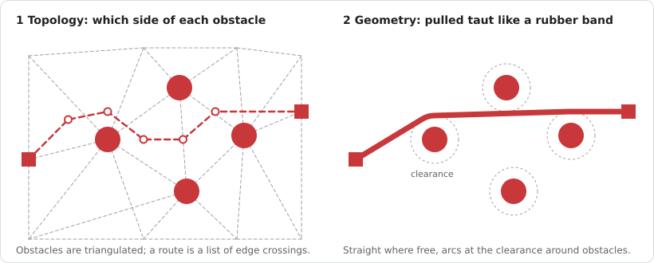

Gummiband first decides on which side of every pad, via and locked track a connection passes,
and only then pulls the planned path taut like a rubber band. The tracks hug the pads at exactly
the clearance, run straight where nothing is in the way and bend in arcs. More in
[How Gummiband routes](concepts.md#topology-first-geometry-second).

## A search that keeps the best

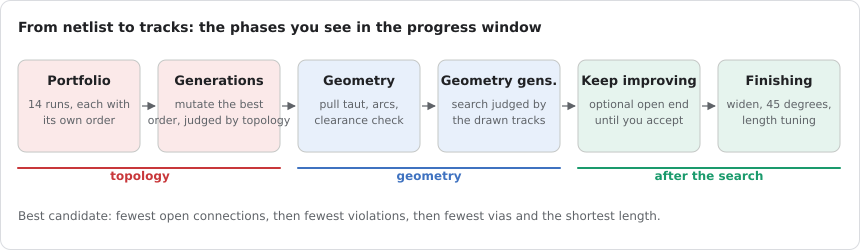

Many routing attempts with different orders run in parallel, an evolutionary search improves the
best order, and the geometry generations judge the drawn tracks by their clearances. With *Keep
improving* (`--until-stop`) the result gets better until you accept it; the progress window shows
vias, length and violations over time.

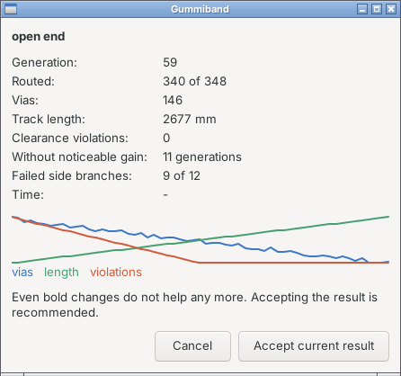

See [Placing and routing in KiCad](kicad-plugin.md#the-dialog) and
[Spend more effort](workflows.md#spend-more-effort).

## Track width: necks, tapers, wider where there is room

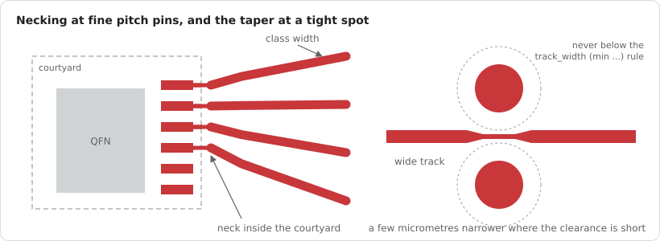

A track has the width of its net class. At fine pitch pins it may neck down inside the part's
courtyard; at a spot that is a few micrometres too tight it gets narrower right there, never below
the minimum of a `track_width (min ...)` rule.

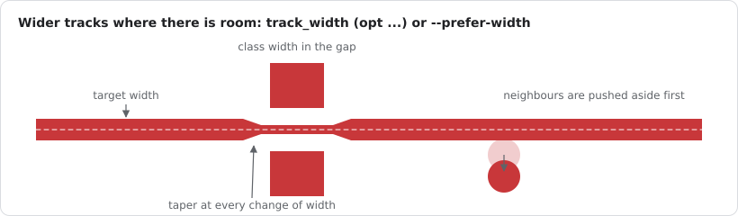

With a target width (`track_width (opt ...)` in the `.kicad_dru`, or *Preferred track width* in
the plugin) tracks grow where there is room, with a taper at every change of width. See
[Track width and necking](concepts.md#track-width-and-necking) and
[Wider tracks where there is room](concepts.md#wider-tracks-where-there-is-room).

## Conventional 45 degree tracks

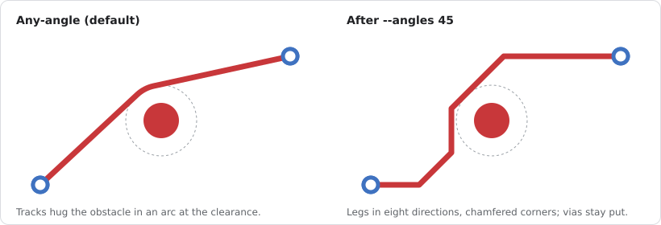

If your reviewer wants 45 degrees, `--angles 45` (plugin: *45 degree tracks*, or the separate
button for a finished board) turns the result into straight legs in eight directions with
chamfered corners. Vias and track ends stay where they are, and no new clearance violation is
allowed.

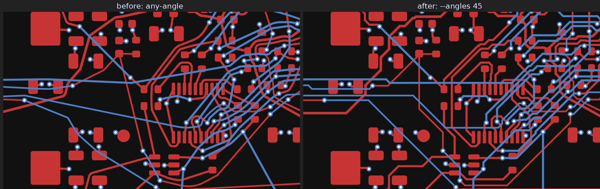

See [Conventional 45 degree tracks](concepts.md#conventional-45-degree-tracks).

## Length matching and skew

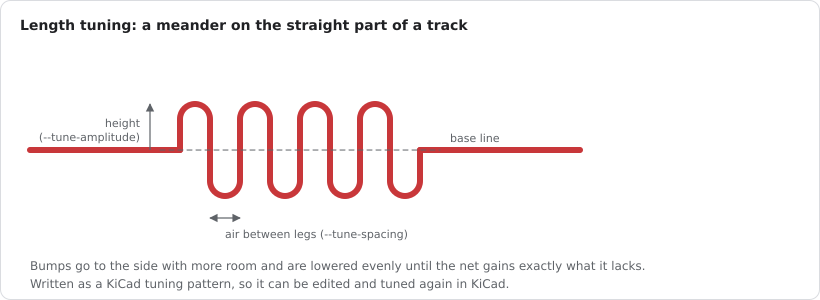

The `length` and `skew` rules of the `.kicad_dru` are read as KiCad reads them. The router makes
room next to nets that are too short, then adds meanders that KiCad treats as its own tuning
patterns. The search already prefers routes of similar length within a skew group.

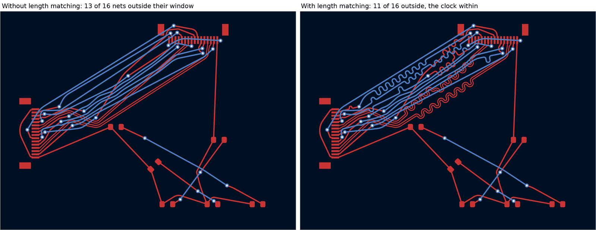

See [Length matching](concepts.md#length-matching) and the
[measurements](benchmarks.md#length-matching).

## Differential pairs

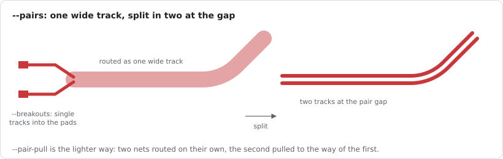

Pairs are recognised by name. `--pair-pull` keeps the two nets together while routing them on
their own; `--pairs` routes a pair as one wide track and splits it in two at the gap from the
rules or an impedance target. `--breakouts` ends the wide track before the pads.

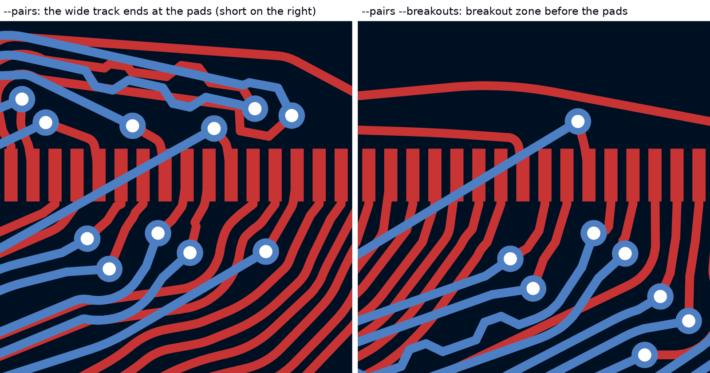

See [Route differential pairs](workflows.md#route-differential-pairs-experimental) and
[Differential pairs](options.md#differential-pairs).

## Dog-bone vias in ball fields

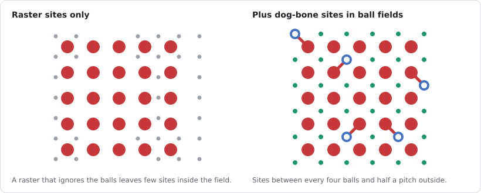

In a ball field the via raster rarely lines up with the balls. Gummiband finds ball fields by
their pad lattice and adds a via site in the middle of every four balls and half a pitch outside
the outer ones, so the fan-out gets the classic dog-bone.

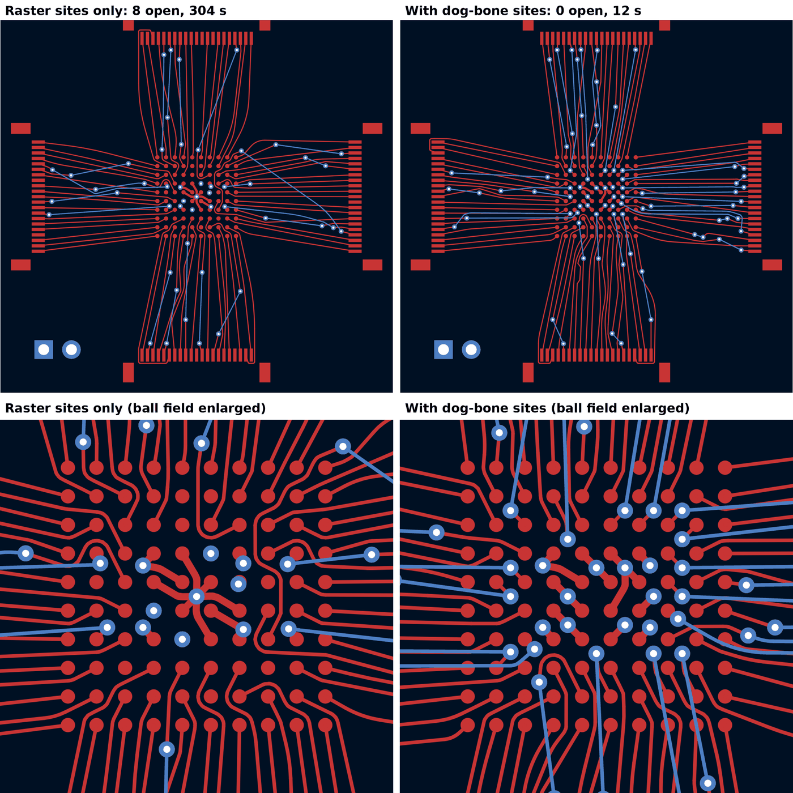

See [Vias](concepts.md#vias).

## Placement from the netlist

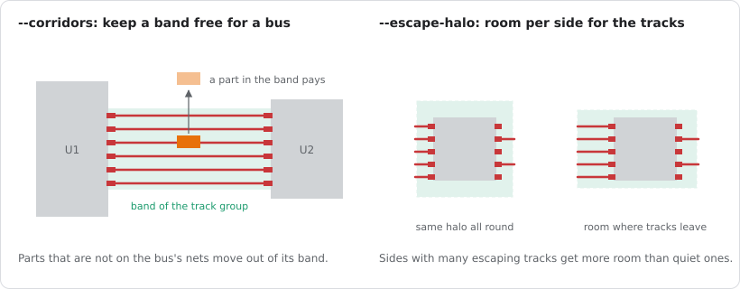

`gummiband place` (and the plugin button *Place with Gummiband*) places the parts that are not
locked. Opt-in terms use the schematic (`--semantic`), keep bands free for buses
(`--corridors`), give each side of an IC the room its tracks need (`--escape-halo`) and place on
both sides (`--two-sided`).

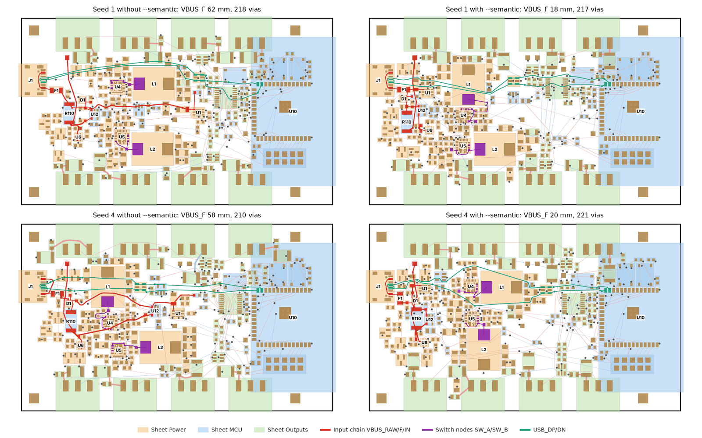

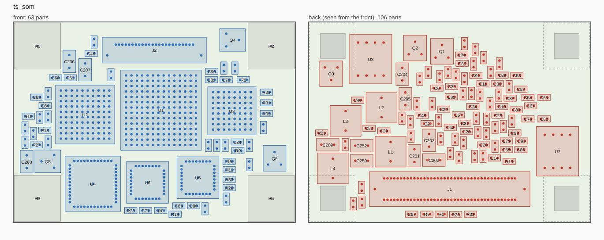

See [Choosing the opt-in options](options.md#room-for-track-groups) and
[Place the parts](workflows.md#place-the-parts).

## Clearing bands for buses before routing

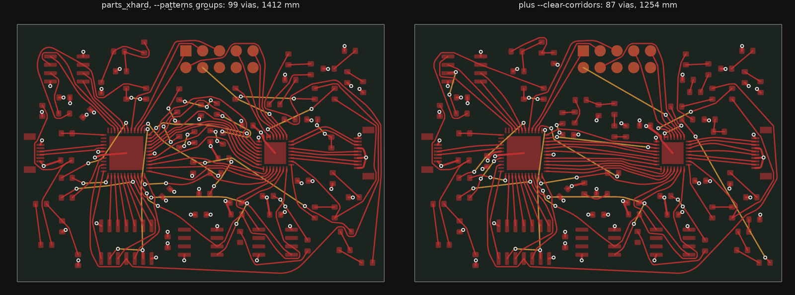

`--clear-corridors` moves small parts out of the band of a bus before routing, together with the
routing order hint `--patterns groups`. See [Room for track groups](options.md#room-for-track-groups).

## Finishing nets and shoving

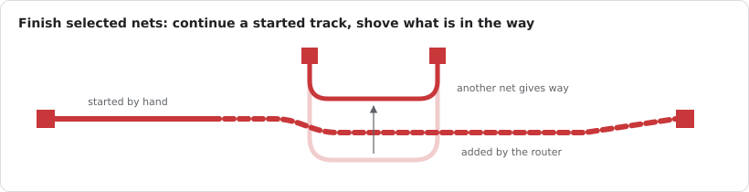

*Finish selected nets* (or `--keep-all --nets`) completes the nets you point at, from where a
track you started ends, and pushes unlocked tracks of other nets aside where it needs the room.
See [Finish a partly routed board](workflows.md#finish-a-partly-routed-board-experimental).

## Good practice for power and signals (MCP)

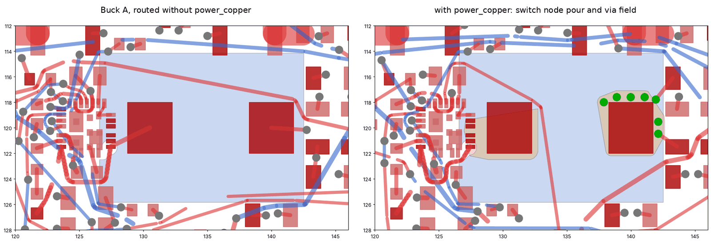

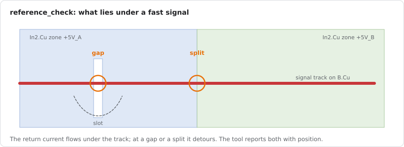

For AI agents the MCP server adds the checks a careful layouter makes: `power_plan` and
`power_copper` before routing (pours and via fields for current paths), `current_check`,
`ground_pour` and `reference_check` after it. See [Working with an AI agent](ai-agents.md).
