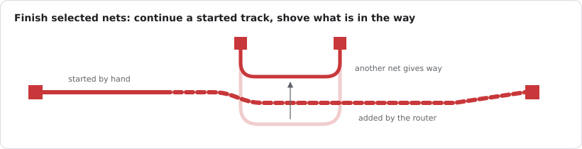
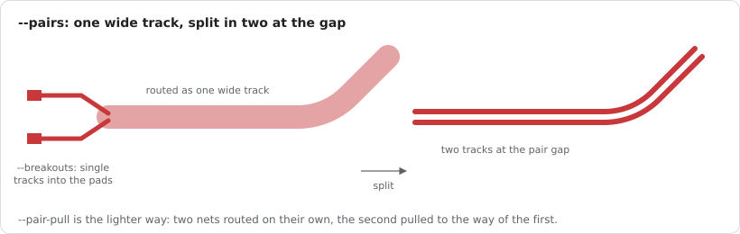
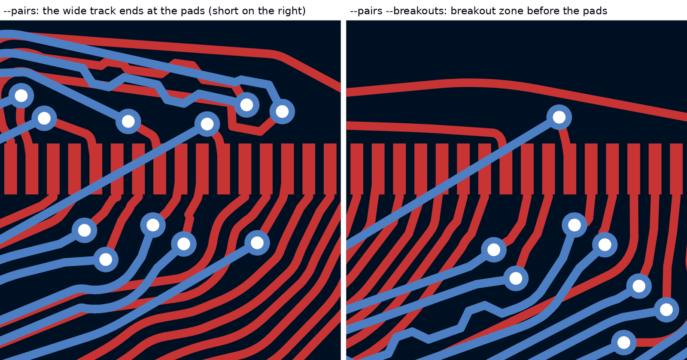
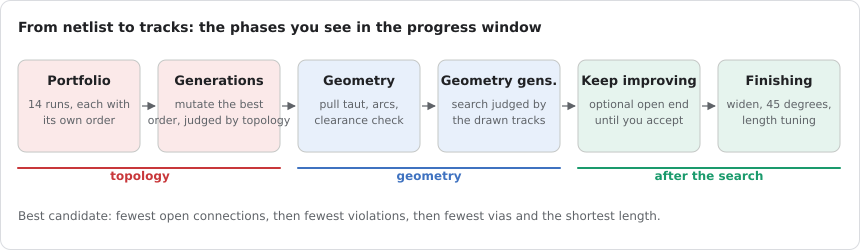
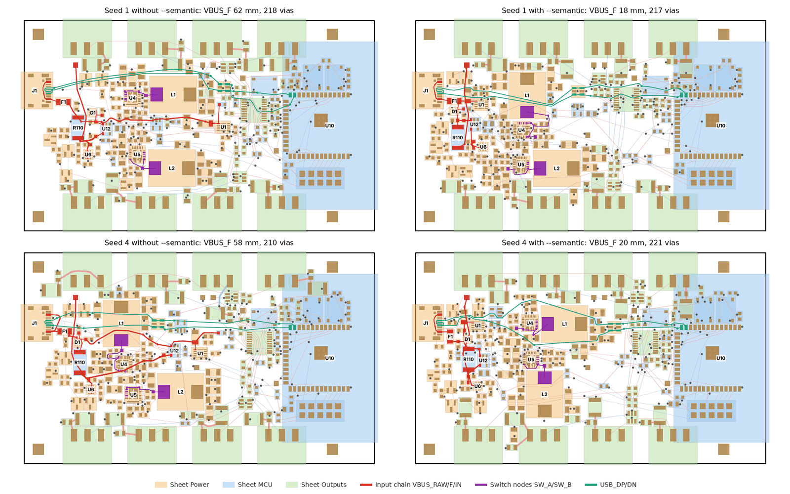

# Workflows

Recipes for everyday routing with Gummiband. They assume the binary is built and, for the KiCad
steps, the plugin is installed ([Installation](installation.md)).

## Route a board for the first time

1. Finish the placement, or let [Gummiband place the parts](#place-the-parts). While routing,
   the router only shifts unlocked parts a little to open channels (see
   [Let parts move](#let-parts-move)); lock the footprints that must stay.
2. Set up net classes in *Board Setup > Net Classes*: track width, clearance, via size. Assign
   nets to classes. Give the classes that matter most (clocks, high current, USB) a lower
   priority number so they are routed first, see [Route by priority](#route-by-priority).
3. Save the project, so the `.kicad_pro` is current.
4. Run `gummiband info board.kicad_pcb` (or just trust the plugin) and check layers, planes and
   classes.
5. Route from the plugin with the defaults, or on the command line:

   ```bash
   gummiband route board.kicad_pcb -o board.routed.kicad_pcb --keep-locked
   ```

6. Refill zones, run the DRC, look at the unrouted connections.
7. Iterate: lock what is good, fix the rest by hand or route again with more effort
   (`--until-stop`, or more `--geometry-generations`).

## Finish a partly routed board (experimental)



```bash
gummiband route board.kicad_pcb -o out.kicad_pcb --keep-all --nets /SDA,/SCL
```

`--keep-all` keeps every existing track and via, locked or not, and `--nets` limits the run to
the named nets. In KiCad the same is the toolbar action *Finish selected nets with Gummiband*:
select a track, via or pad of the nets and click, see [Routing in KiCad](kicad-plugin.md).
The router adds to what is there: pins that already sit on one piece of copper count as
connected, and a connection may ride along existing copper of its net instead of drawing a new
track beside it. Unlocked tracks of other nets shift aside where the new track needs room
(`--shove`), and when even that is not enough, those within 8 mm of the pins are rerouted
(`--give 8`); a try that leaves more open than the one before is dropped. Both are on by
default, `--no-shove` and `--give 0` switch them off. Locked copper and plane nets stay in any
case. This is new, so refill the zones and run the DRC afterwards.

## Pre-route and lock power lanes

The router has no notion of "this lane should be wide and straight": it gives a net the width
of its class and the shortest path. For power you usually know better. So:

1. Route the power paths by hand in KiCad (or let the router do a first pass and keep the lanes
   you like).
2. Select those tracks and vias, right click, *Locking > Lock*.
3. Route with *Keep locked tracks and vias* on (the plugin default) or `--keep-locked`.

Locked copper is an obstacle of its net. Its ends count as pins, so a signal that has to reach a
locked lane ends on the lane instead of on the far pad. The same works for the layout a datasheet
asks for around a converter or an eFuse: draw it, lock it, let the router do the rest around it.

Zones are kept in any case. Keepout areas are honoured as obstacles on their layers.

## Route by priority

Nets are routed in order of their net class priority (lower first); within a class the search
decides the order and reorders failed connections forward. The priority field is in the net class
setup of the `.kicad_pro`. Classes without a priority come last.

Per net overrides come from a JSON file:

```bash
gummiband route board.kicad_pcb -o out.kicad_pcb --net-priorities prio.json
```

```json
{"USB_D+": -20, "USB_D-": -20, "XTAL_IN": -10, "XTAL_OUT": -10,
 "COL0": 10, "COL1": 10, "ROW0": 10, "VCC": 20, "GND": 30}
```

Lower numbers route first; nets not in the file keep their class priority. The MCP server has the
same through `set_net_options` (`priority` per net, plus a `skip` flag that leaves a net out), so
an agent can route the critical nets first, judge, then the rest. See
[MCP.md](../MCP.md#set_net_options). The file of `--net-widths` takes the same fields per net
(`width`, `min_width`, `neck_refs`, `priority`, `skip`), see [the CLI reference](cli.md).

A hint from one measurement on one board (the Corne keyboard): routing USB and crystal first,
then the other signals, then the key matrix, and the supply and GND last gave the best result,
with more connections routed and fewer violations at the cost of a few more vias. Groups like
that are a sensible starting point; the right order for your board is a matter of trying.

## Route differential pairs (experimental)

Name the nets as KiCad pairs them (`USB_D_P`/`USB_D_N`, `CLK+`/`CLK-`, `DP`/`DN`), give them a
net class with the single track width, and set the pair rules in the `.kicad_dru` if you have
them: `diff_pair_gap` and `track_width` constraints, also per `(layer inner)` or `(layer outer)`,
and a `skew` constraint. Then:

```bash
# the gentle way: two nets, the second pulled to the way of the first
gummiband route board.kicad_pcb -o out.kicad_pcb --keep-locked --pairs pull
# one wide track per pair that has a pair rule or a net class of its own
gummiband route board.kicad_pcb -o out.kicad_pcb --keep-locked --pairs band
# with an impedance target: width per layer from the stackup, the gap stays
gummiband route board.kicad_pcb -o out.kicad_pcb --keep-locked --pairs band --pair-zdiff 90
```

`--pairs pull` works for every pair recognised by name and suits a board that is not dense; the
tracks close up to the pair gap where nothing lies between, and `--pair-pull W` sets the weight
(1 by default). With `--pairs band` each pair is routed as one wide track and split into two parallel tracks afterwards; the shorter
track gets bumps until the length difference is below `--pair-skew` (0.1 mm by default) or the
`skew` rule. The console and the JSON report list every pair with width, gap, estimated
impedance, lengths, skew and vias. Where a pair could not be routed wide, the line says why and
the pair is routed as two single nets.

This is new. It costs connections on dense boards and can leave clearance errors or shorts next
to pads and vias, so compare the KiCad DRC with and without `--pairs band` before you keep the result.



At connector rows `--breakouts` (with `--pairs band`) ends the wide track just outside the pads and runs two short
tracks in, which avoids the shorts the split can leave right at the pads:



## Judge a result

Three sources tell you how good a routing is:

- **The router's summary** at the end of the run (and in the plugin's message box): routed
  connections, vias, length, how far above the length lower bound, and the violations of its own
  clearance check.
- **The JSON report** (`--report out.json`): the same with positions and nets for every
  violation, and every candidate of the search. Scripts and agents read this.
- **KiCad's DRC**: the judge. `kicad-cli pcb drc --refill-zones --format json -o drc.json
  board.routed.kicad_pcb` (with the `.kicad_pro` next to it), then `bench/drc_report.py drc.json`
  for counts per type, a deficit histogram and the worst clearances with positions.

Typical for this early version on a dense board: a handful of clearance violations with deficits
of a few micrometres (nudge a track), occasionally a crossing or short in a BGA fan-out (reroute
that net by hand or lock the fan-out and run again).

## Spend more effort

Effort knobs, from cheap to expensive:

| Want | Do |
| --- | --- |
| more orders tried per phase | `--runs 28` (the default 14 is a constant; runs are spread over the threads) |
| better order | `--generations 6` |
| fewer violations in the drawn tracks | `--until-stop`, or more than the default 3 `--geometry-generations` |
| fewer vias | `--via-cost 5` |
| shorter tracks, more vias | `--via-cost 1.5` |
| tidier two layer boards, one direction per layer | `--layer-dirs 1` (0 switches the preference off) |
| finer via placement in tight spots | `--via-pitch 0.25` |
| the last connections on a dense board | nothing: the search negotiates on its own when a few stay open; `--negotiate 20` does it from the start |

The search is deterministic: the same board, options and `GB_EVO_SEED` give the same result with
any `--threads`; the thread count only changes the run time. It is designed to give the same
result on every machine as well (verified on x86_64 Linux with glibc and with musl, see
[Concepts](concepts.md)). Set a different `GB_EVO_SEED` to get another attempt.

## Let parts move

```bash
gummiband route board.kicad_pcb -o out.kicad_pcb --keep-locked \
    --geometry-generations 3 --fixed U1,Y1
```

The geometry generations may shift unlocked parts that sit next to clearance problems or open
connections by a small amount to open a channel (`--move-parts`, on by default when the whole
board is routed; `--no-move-parts` keeps every part where it is). The routed copper goes along like rubber bands:
the parts move in small steps, the tracks give way within their clearances, and a shift stops
where nothing can give way any more. Only if that does not solve the problems is the search run
again on the shifted board.
Connectors, modules, mounting holes, switches, jumpers and test points never move, nor do locked
footprints or the references in `--fixed`. The console lists every move
(`moved R8 by 0.30, 0.00 mm`) and the output file has the footprints at the new positions. This
is a command line feature for now; the plugin does not import footprint moves.

Lock a footprint in KiCad (*Locking > Lock* on the part) to keep it from moving.

**Blocks** (preliminary): put the parts of a pre-routed cell, say a converter with its locked
tracks and vias, into a KiCad group (select them, right click, *Grouping > Group*). Under
`--move-parts` the group moves as one block, copper included, so the layout inside stays intact.
A group with a locked or fixed member does not move at all. Zones inside a group are not moved
yet, and moving blocks on a real board is untested.

## Keep the designer's track widths

When you re-route an existing board and want the same widths the designer used per net:

```bash
bench/net_widths.py original.kicad_pcb --json widths.json   # also prints length and via totals
gummiband route stripped.kicad_pcb -o out.kicad_pcb --net-widths widths.json
```

The JSON is plain `{"net name": width_mm}`; you can write it by hand for a few nets.

## Watch the search

```bash
gummiband route board.kicad_pcb -o out.kicad_pcb --frames frames/
open frames/evolution.gif
```

`--frames` writes the best candidate after every phase as SVG, converts it to PNG with
`rsvg-convert` and joins the PNGs into `evolution.gif` with ImageMagick. In the plugin, tick
*Save an animation of the generations*; the images go to `gummiband-evolution/` next to the
project.



`--svg out.svg` draws the final result with its violations, `--svg-tris` adds the triangulation
the router plans on. Both open in any browser.

## Place the parts

Before routing, in KiCad with the *Place with Gummiband* button, or on the command line with
[`gummiband place`](cli.md#gummiband-place):

1. Put the connectors, the module and whatever else has a fixed spot on the board and lock it.
2. Pick what should move: the selected parts, the parts still outside the board, or all unlocked
   ones. The parts you have not picked stay and the moving ones work around them.
3. Look at the result, move what you want by hand, lock it and place the rest again if you like.
4. Route.

Two things to know: the placer has no datasheet knowledge, so the layout of a converter or a
crystal is yours to make and lock first, and the seeds differ a lot, so `--seed 2`, `--seed 3`
and a look at the routed results is worth the minutes (the plugin dialog has a *Seed* field with
a *New* button). For a placement from scratch start with `--semantic --corridors --escape-halo`;
`--two-sided` gives each side of the board its own room when the parts do not fit on one. See
[Choosing the opt-in options](options.md#room-for-track-groups).



An agent does the same over MCP: `move_part` for the parts it has a plan for, `place_parts` with
`fixed` or `only` for the rest, then `route`.

To let the router pick, `route --placements 12` tries twelve placements and keeps the best one, so
the seed lottery of the placer turns into a search. In KiCad it is *Placements to try* in the route
dialog. An agent loops over `place_parts` and `route` itself.

## Try placement variants

The `variants` example of the placement crate
(`cargo run --release -p gummiband-place --example variants -- BOARD -o OUT`) rebuilds the LED
controller controller in another outline (smaller rectangle, square, circle) with the connectors
and the module fixed and the inner planes regenerated, so the router can be tried on alternatives
of the same design. It is specific to that board's part roles today; the scripts and parameters are in
[bench/place/README.md](../../bench/place/README.md).

## Drive the router from an AI agent

The MCP server lets Claude Code, Claude Desktop and other MCP clients drive the whole sequence:
`create_board` or `load_board`, `set_layer_type` and `add_zone` for the planes, `power_plan` and
`power_copper` for the current paths, `place_parts`, `route` (with the search options of the CLI,
including `seed` and `keep_all`), then `current_check`, `ground_pour`, `reference_check`, `drc`
and `render`. An agent can give the critical nets priority, route, read the violations with
positions and the nets that block each unrouted connection, look at a PNG of the region, nudge a
part and iterate. On a finished board it can re-lay single nets: `route` with `keep_all`, `nets`
and `reroute` removes the unlocked copper of those nets and routes them anew while everything
else stays, and unlocked tracks of other nets shift aside where needed. The automatic steps
complement the agent's own work: it can place and route by hand, lock parts and nets (`lock`) and
refine the result after `place_parts` and `route`, and the tool `guide` gives it this workflow and
the reference of every tool. The chapter [Working with an AI agent](ai-agents.md) walks through a
session.

New and preliminary: datasheet guided pre-routing. The agent asks `part_info` for the pads,
courtyard and neighbours of a critical part, places the copper the datasheet recommends with
`add_locked_copper` (tracks as polylines, vias; written as locked items into a working copy
`<input>.prerouted.kicad_pcb`, your input stays untouched), checks it with `render`, and then
routes the working copy, where the router keeps the pre-routed copper and attaches to it. Setup
and tool reference in [MCP.md](../MCP.md).
